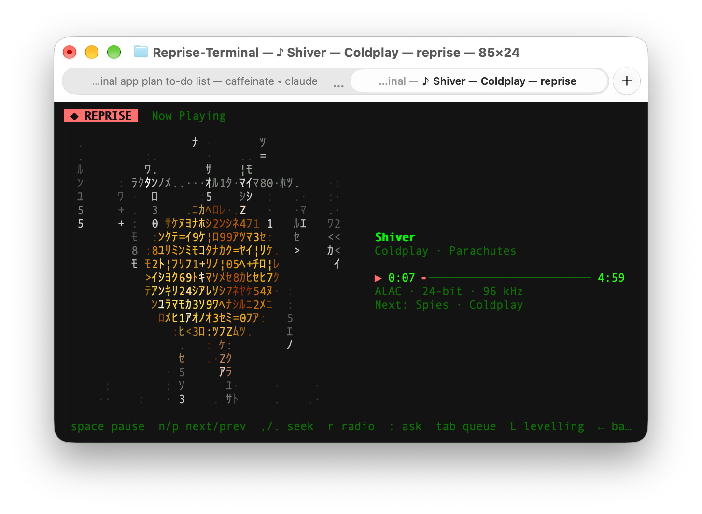
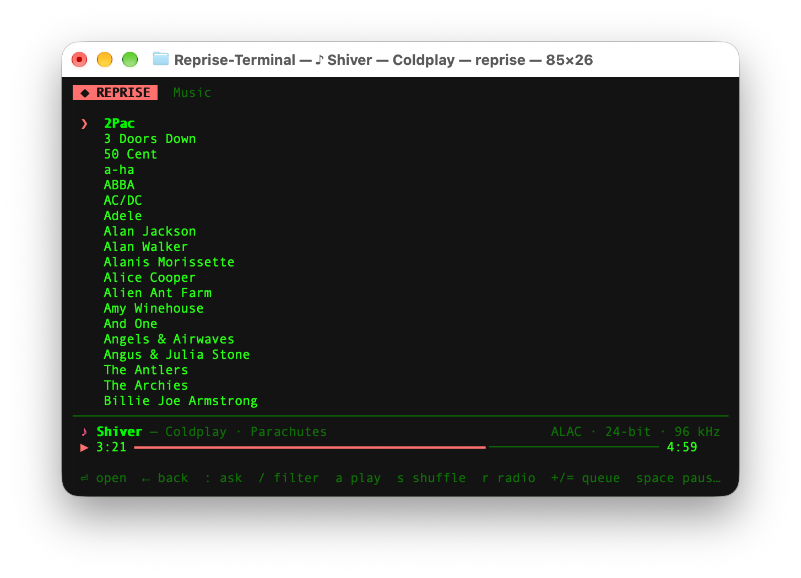
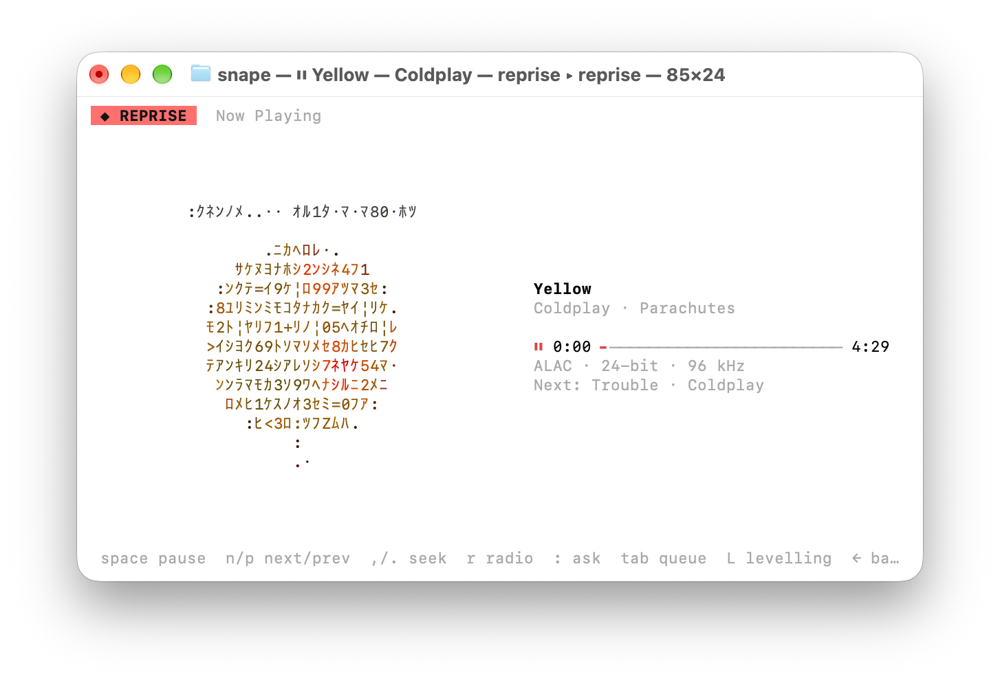
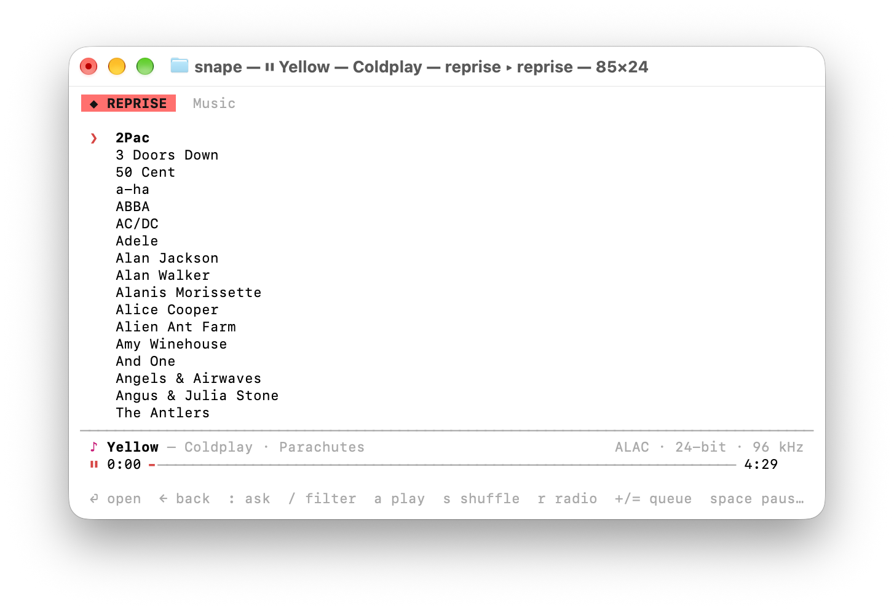

# Reprise Terminal

Your Plex music library, played in a terminal window.

A full-screen, keyboard-driven player for macOS: browse your music library by artist, album
and track, or just ask for what you want, and play it, gaplessly and in its original quality,
without leaving the terminal. The Now Playing screen draws the album cover as falling
Matrix-style text in the cover's own colours.
It is the terminal sibling of [Reprise for Mac](https://github.com/andrew-snape/Reprise-Mac)
and shares its Plex code.





It reads the terminal's background and adjusts for light themes such as Terminal's Basic profile:





## Requirements

- An Apple silicon Mac running macOS 27 or later
- A Plex Media Server with a music library
- To build from source: Swift 6.2 or later (comes with Xcode)

## Install

Download `reprise-<version>-macos-arm64.tar.gz` from the
[latest release](https://github.com/andrew-snape/Reprise-Terminal/releases/latest), then:

```sh
tar -xzf reprise-*-macos-arm64.tar.gz
xattr -d com.apple.quarantine reprise     # the binary is unsigned
mkdir -p ~/.local/bin && mv reprise ~/.local/bin/
reprise
```

`~/.local/bin` needs to be on your PATH; any folder on it will do.

Or build from source:

```sh
git clone https://github.com/andrew-snape/Reprise-Terminal.git
cd Reprise-Terminal
scripts/install.sh        # builds a release build and links ~/.local/bin/reprise
reprise
```

## Updating

`reprise update` replaces a downloaded copy with the latest release, after checking the
new binary runs. Reprise also checks once a day and mentions a new version at the bottom of
the screen. A copy built from source updates with `git pull && scripts/install.sh`.
Copies older than 0.1.5 don't have `reprise update`: download 0.1.5 or later once by hand.

## First run

Reprise shows a four-letter code. Go to **plex.tv/link**, enter it, and Reprise signs in.
If your account has more than one server, it asks which one to use. It remembers both.

```
reprise              browse and play
reprise <request>    start playing what you ask for: reprise mellow radiohead
reprise --server     choose a different server
reprise --sign-out   forget this Mac's Plex sign-in
reprise update       update to the latest release
reprise --version    show the version
```

## Keys

| Key | Action |
|---|---|
| ↑ ↓ or j k | Move |
| ⏎, → or l | Open, or play from this track |
| ←, esc or h | Back |
| / | Filter the list as you type (⏎ opens the selection, esc clears) |
| : | Ask: "play ghosteen", "some mellow 90s rock", "mellow radiohead", "more like this", "queue this album". ↑ ↓ bring back earlier requests |
| a / s | Play / shuffle the selection, or the track list showing |
| r | Radio: similar music from the selection (or what's playing) |
| + / = | Play the selection next / add it to the end of the queue |
| x | Remove from the queue (on the queue page) |
| space | Pause or resume |
| n / p | Next / previous track (p restarts the track after 3 s) |
| , / . | Seek back / forward 10 s |
| v | Now Playing screen, with the album cover |
| tab | Show the queue |
| P | Playlists |
| L | Loudness levelling on or off |
| A | Next album after an album on or off |
| PgUp PgDn, g G | Page, jump to top or bottom |
| q | Quit (music stops) |

## How it plays

- Files AVFoundation can open (MP3, AAC, ALAC, FLAC, WAV, AIFF) play as the original file.
  Anything else (Opus, Vorbis, WMA, DSD), and every track over a Plex relay connection,
  plays as a 320 kbps AAC transcode. The bottom bar shows which.
- An album plays gaplessly. When a whole album reaches its last track, the artist's next
  album by release date is added to the queue and follows on (`A` turns this off).
- Ask uses Apple Intelligence on the Mac to understand the request, and Plex to find the
  music; without Apple Intelligence it is a keyword search. Nothing leaves the Mac but the
  search itself, sent to your Plex server. The last 20 requests are kept in
  `~/Library/Application Support/reprise-cli/asks.json`, readable only by you.
- Loudness levelling uses Plex's own loudness analysis, so quiet and loud albums sit
  together. It only ever turns music down.
- The queue is saved when you quit and comes back, paused, next time. Its track downloads
  while paused, so space starts it at once.
- The playing track shows in Control Centre, and the keyboard's media keys work.
- Plex hears what you play, so play counts and history work the same as in other Plex apps.
- The next two tracks are downloaded as you play, so skips start at once and replays
  need no network. Up to 4 GB is kept in `~/Library/Caches/reprise-cli/audio`, the
  least recently played going first; delete the folder to clear it.

## Privacy and your sign-in

- Your Plex token is saved in `~/Library/Application Support/reprise-cli/config.json`,
  readable only by you. `reprise --sign-out` deletes it.
- Reprise Terminal never reads or writes the Keychain. If macOS ever asks whether
  "reprise" may use the `com.rivulet.plex` keychain item (Reprise for Mac's), click **Deny**.
- Nothing is sent anywhere except your Plex server and plex.tv, plus a once-a-day check of
  GitHub for a new release (an anonymous request for the latest version number).

## If it ever gets stuck

Close the tab, or run `pkill -9 reprise` from another tab, then `reset` to restore the terminal.

## Licence

PolyForm Noncommercial 1.0.0. See [LICENSE](LICENSE). The Plex code in
`Sources/reprise/RivuletCore` comes from Reprise for Mac, a port of Rivulet by Bain Gurley.
